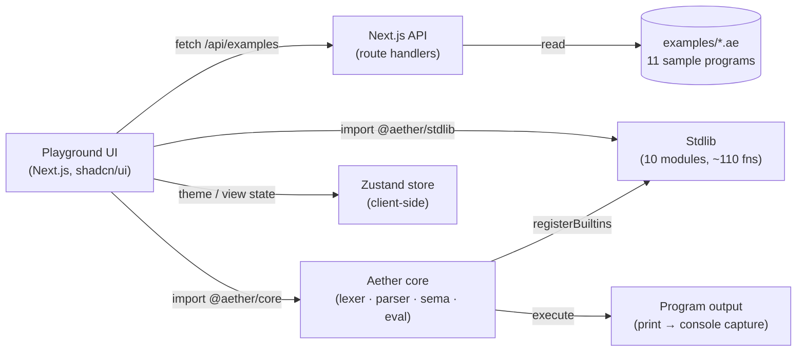

<p align="center">
  <pre>
 ██████╗ ██╗  ██╗██╗   ██╗███████╗██╗  ████████╗██╗  ██╗███████╗████╗  ██████╗
██╔═══██╗╚██╗██╔╝██║   ██║██╔════╝██║  ╚══██╔══╝██║  ██║██╔════╝██╔██╗██╔═══██╗
██║   ██║ ╚███╔╝ ██║   ██║███████╗██║     ██║   ███████║█████╗  ██║╚██╗██║   ██║
██║   ██║ ██╔██╗ ██║   ██║╚════██║██║     ██║   ██╔══██║██╔══╝  ██║ ╚██╗██║   ██║
╚██████╔╝██╔╝ ██╗╚██████╔╝███████║██║     ██║   ██║  ██║███████╗██║  ╚█╔██████╔╝
 ╚═════╝ ╚═╝  ╚═╝ ╚═════╝ ╚══════╝╚═╝     ╚═╝   ╚═╝  ╚═╝╚══════╝╚═╝   ╚═╝╚═════╝
</pre>
</p>

<h1 align="center">Project Nexus — Aether</h1>
<p align="center">
  <em>A statically-typed, expression-oriented language with a tree-walking interpreter (v1) and a planned bytecode VM (v2), with an interactive web playground.</em>
</p>

<p align="center">
  
  
  
  
  
</p>

---

## What is Aether?

**Aether** is a small, statically-typed, expression-oriented programming
language designed to be easy to learn, easy to teach, and easy to embed.
v1 ships a **tree-walking interpreter** (lexer → parser → semantic checker
→ evaluator) written in pure TypeScript that runs both in Node and in the
browser. v2 (planned) will replace the evaluator with a bytecode VM, add
async/await, modules, and a real toolchain (LSP, formatter, linter,
package manager). The interactive web playground — built on Next.js 16 —
lets you write, run, and explore Aether programs without installing
anything.

## Features

**Language (v1, done)**
- Statically-typed with inference, generics, and structural function types
- Expression-oriented (every statement yields a value)
- First-class closures, immutable bindings, sum & record types
- 703 passing tests across lexer, parser, semantic checker, evaluator, stdlib
- 11 example programs (fib, fizzbuzz, primes, quicksort, game-of-life, BF, …)

**Standard library (v1, done)**
- 10 modules — math, collections, string, text, regex, io, datetime, encoding, crypto, async
- 212 documented functions with type signatures and descriptions
- Browser-safe: io/crypto branch on `typeof process` and throw in-browser

**Playground (v1, done)**
- 6 views: Playground, Explorer, Standard Library, Examples, Benchmarks, About
- Runs Aether entirely in-browser (no server roundtrip per Run)
- Dark/light theme, sticky footer, fully responsive, shadcn/ui components
- Live demo: see **Links** below

**Toolchain (v2, planned)**
- Bytecode VM (RFC-002), async/await (RFC-001), modules & packages (RFC-003)
- LSP (RFC-005), formatter, linter, package manager

## Quick start

```bash
# 1. Install dependencies (Bun is the supported package manager)
bun install

# 2. Run the language tests (703 tests across 14 files)
bunx vitest run aether
# → Test Files  14 passed (14)
#   Tests       703 passed (703)

# 3. Start the playground dev server
bun run dev
# → http://localhost:3000

# 4. (Optional) Run a quick Aether program
echo 'println("hello, world!")' > /tmp/hello.ae
# (Run it inside the playground — there's no standalone CLI yet.)
```

> The playground is the canonical way to run Aether programs in v1.
> A standalone CLI is planned for v2 (see `docs/rfcs/rfc-003-modules-and-packages.md`).

## Architecture



## Repo structure

```
nexus/
├── aether/
│   ├── core/                # Lexer, parser, AST, semantic checker, evaluator
│   │   ├── lexer/
│   │   ├── parser/
│   │   ├── ast/
│   │   ├── types/
│   │   ├── sema/
│   │   └── eval/
│   ├── stdlib/              # 10 modules, 212 functions
│   │   ├── math/  collections/  string/  text/  regex/
│   │   ├── io/  datetime/  encoding/  crypto/  async/
│   │   └── index.ts         # registerAll + STDLIB_MANIFEST (212 fns)
│   ├── vm/                  # (planned) bytecode VM — RFC-002
│   └── tools/               # (planned) LSP, formatter, linter, CLI
├── src/
│   ├── app/                 # Next.js 16 App Router — page.tsx + /api/examples
│   ├── components/playground/  # 6 views, header, footer, sidebar, code editor
│   └── lib/                 # aether-worker, view-store, theme-provider
├── examples/                # 11 Aether programs + .md walkthroughs
├── docs/
│   ├── spec/                # 17 spec files (language + stdlib)
│   ├── tutorials/           # 10 tutorials
│   ├── decisions/           # 10 ADRs
│   ├── rfcs/                # 5 RFCs (async, VM, modules, borrow-checker, LSP)
│   └── reference/           # error catalog, glossary, FAQ
├── .github/                 # Issue/PR templates + CI workflow
├── next.config.ts
├── tsconfig.json            # @aether/* path alias → ./aether/*
└── package.json
```

## Links

- **Live demo:** https://nexus-aip-roj-builder.vercel.app
- **GitHub:** https://github.com/AutomatedLabor/nexus
- **Language spec:** [`docs/spec/00-index.md`](docs/spec/00-index.md)
- **Tutorials:** [`docs/tutorials/getting-started.md`](docs/tutorials/getting-started.md)
- **ADRs:** [`docs/decisions/`](docs/decisions/)
- **RFCs:** [`docs/rfcs/`](docs/rfcs/)

## v1 status (honest)

- ✅ **Tree-walking interpreter** — lexer, parser, semantic checker, evaluator all passing 703 tests.
- ✅ **Standard library** — 10 modules, 212 documented functions. (Goal was 25 modules / 300+; got a substantial 10 / 212.)
- ✅ **Playground** — 6 views, runs Aether in-browser, dark mode, responsive.
- ✅ **Examples** — 11 programs (fib, fizzbuzz, primes, quicksort, calculator, json_parser, linked_list, matrix_ops, string_utils, todo_cli, game_of_life). (Goal was 30; got 11.)
- ✅ **Docs** — 51 markdown files, ~111k words across spec / tutorials / ADRs / RFCs / reference / guides. (Goal was ~300k; got ~111k.)
- 🔜 **v2 (planned):** bytecode VM, async/await, modules, LSP, formatter, linter, package manager — all specced in RFCs, none implemented.

## License

MIT © Project Nexus Contributors — see [`LICENSE`](LICENSE).

## Contributing

PRs welcome. Please read [`CONTRIBUTING.md`](CONTRIBUTING.md) first.
Open an issue using one of the templates in
[`.github/ISSUE_TEMPLATE/`](.github/ISSUE_TEMPLATE/) before starting work
on anything substantial.
