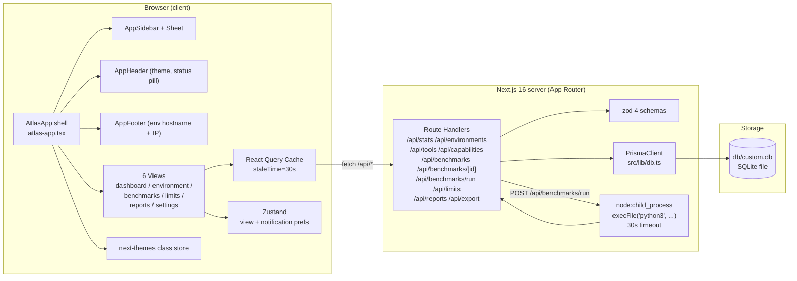
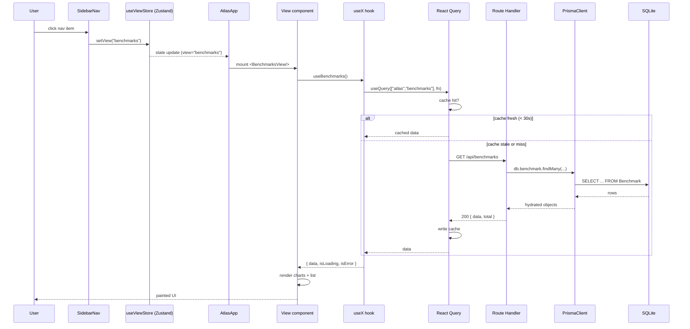
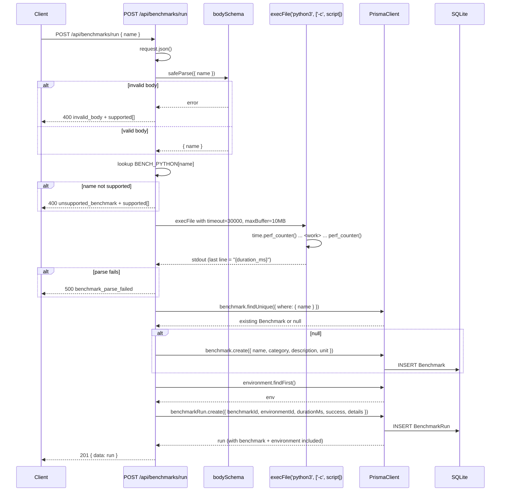
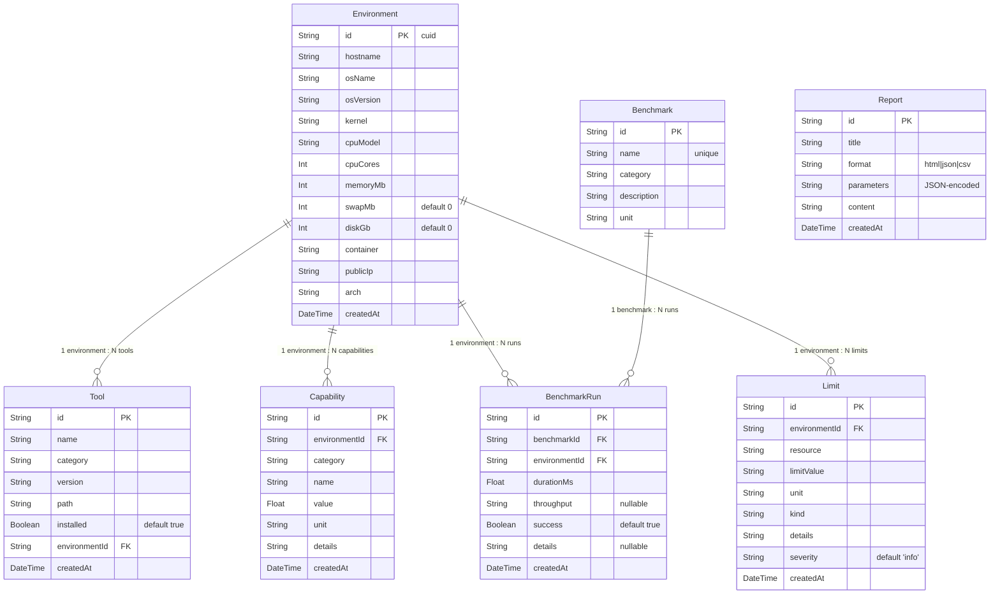
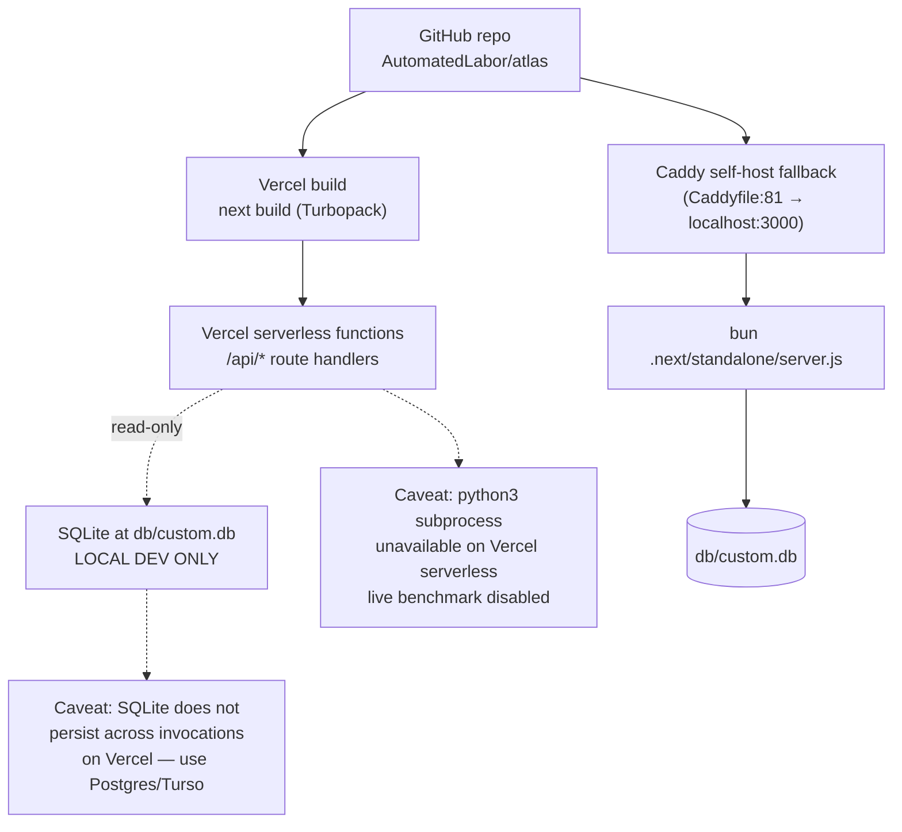

# ATLAS — System Architecture

> Autonomous Technical Limit Assessment System. A read-heavy Next.js 16
> dashboard that visualizes the capability, limits, and benchmark
> performance of the sandbox the agent itself runs in. This document is
> the canonical reference for how the pieces fit together. It was
> written by reading the source: `prisma/schema.prisma`,
> `src/app/api/**/route.ts`, `src/lib/*.ts`, `src/components/atlas/**`,
> `src/hooks/atlas/index.ts`, `src/types/atlas.ts`, `next.config.ts`, and
> `package.json`. Cross-links to the ADRs in [`./decisions/`](./decisions)
> appear throughout.

## 1. Overview

ATLAS is a single-tenant, internal dashboard. One environment is
registered (a Debian 13 kata-container, 2 vCPU Intel Xeon, 4.1 GiB
RAM, no swap, egress IP `8.212.10.159`), and the application reports
that environment's tools, capabilities, benchmark runs, and hard
limits through six client-side views. The application is served from
a single Next.js 16 App Router route (`/`) which renders the
client-shell `<AtlasApp />`. There is no second page in the user-facing
application; view switching happens entirely client-side through a
Zustand store. The eleven API route handlers under `/api/*` are the
only server surface.

The stack was chosen to fit a constrained sandbox: 4.1 GiB RAM, zero
swap, a restricted writable surface (`/home`, `/opt`, `/srv` are
read-only; only `/tmp`, `/home/z`, and the project tree are writable).
The stack is:

- **Next.js 16 (App Router)** with Turbopack and `output: "standalone"`,
- **TypeScript 5** with `next.config.ts#typescript.ignoreBuildErrors=true`
  and a manual `bunx tsc --noEmit` gate (see ADR-01),
- **Tailwind 4** with `@tailwindcss/postcss` and `tw-animate-css`,
- **shadcn/ui (New York style)** primitives under `src/components/ui/`
  (see ADR-10),
- **Prisma 6** with the SQLite provider and a single local file
  `db/custom.db` driven by `DATABASE_URL` (see ADR-02),
- **React Query 5** for server state — `staleTime: 30_000`,
  `refetchOnWindowFocus: false`, `retry: 1` (see ADR-04),
- **Zustand 5** for the active view and notification prefs (ADR-03),
- **recharts 2** for every chart (ADR-05),
- **framer-motion 12** for view transitions and list animations,
- **next-themes** with `attribute="class"` + `defaultTheme="system"`
  for dark/light/system theme switching,
- **sonner** for toasts (mounted at the root layout as
  `<SonnerToaster position="bottom-right" richColors closeButton />`),
- **lucide-react** for icons,
- **zod 4** for request validation in every route handler.

The single-route design is deliberate: ADR-09 records the trade-off
between deep-linkable multi-page routing and instant client view
switching. The team chose instant. The cost — no deep links, the
browser back button does nothing — was accepted because ATLAS is an
internal single-user dashboard.

The data layer is intentionally simple: one SQLite file, one
`PrismaClient` instance cached on `globalThis` to survive Next.js
hot-reloads in dev (`src/lib/db.ts`). The Prisma client is registered
in `next.config.ts#serverExternalPackages` so Turbopack does not try
to bundle the native `.node` binding. Prisma's `query` log is
disabled in dev because under the 4.1 GiB cgroup limit it produced
~30 KB of stdout per request and competed with Turbopack's compile
memory, contributing to OOM-kills; only `warn` and `error` logs
remain enabled.

## 2. High-level component diagram



The browser is the entire user surface. The Next.js server is an API
plus a single HTML shell. The Prisma client is the only thing that
touches SQLite, and the only thing that spawns a child process is the
benchmark runner endpoint.

## 3. Data flow — view navigation and data fetch

This sequence shows what happens when the user clicks a nav item. It
is the hot path for the whole application:



The store update and the data fetch are independent. The view
component mounts synchronously when the store flips, then React
Query decides whether to fetch or read from the cache. Because the
default `staleTime` is 30 seconds, a typical Dashboard → Benchmarks
→ Dashboard round-trip issues zero network requests after the first
load. This is what makes the single-page pattern viable — ADR-04
settled on React Query rather than SWR or bare `useEffect+fetch`
precisely so this cache could be shared across views.

## 4. Live benchmark run sequence

`POST /api/benchmarks/run` is the only mutating endpoint that does
real work. It spawns a Python subprocess, parses stdout for the
duration in milliseconds, and inserts a `BenchmarkRun` row. Four
benchmarks are supported: `csv_generate_1m`, `sha256_10k`,
`fib_recursive_30`, `matmul_100x100`. The other six seeded benchmarks
are inspect-only.



The subprocess is killed at 30 seconds by Node's `execFile` timeout
per the ATLAS spec. Python writes a single line of stdout —
`f"{(e - s) * 1000:.3f}"` — which the route handler parses with
`parseFloat`. If the parse fails (Python crashed, the line wasn't a
number, stdout was empty), the handler returns a 500 with the raw
stdout and stderr attached for debugging. The seed benchmark for
`fib_recursive_30` ran in 122.778 ms; `sha256_10k` in 5.532 ms;
`matmul_100x100` in 64.154 ms; and `csv_generate_1m` in 291.832 ms
against the seeded sandbox — all well under the 30-second budget.

**Serverless caveat.** The Vercel serverless runtime does not ship
`python3` on PATH and does not guarantee a writable `/tmp` past a
single invocation. The live benchmark endpoint is therefore
documented as unsupported on Vercel; the deployment guide records a
Caddy self-host fallback where the same `bun .next/standalone/server.js`
binary runs in the sandbox with `python3` available.

## 5. Database ERD

Seven Prisma models. Every model has a cuid `id`. Six of the seven are
scoped to an `Environment` via `onDelete: Cascade`; `Report` is
standalone. SQLite is the datasource; the URL comes from
`DATABASE_URL` (`env("DATABASE_URL")`).



Cascade deletes are set on `Tool.environmentId`,
`Capability.environmentId`, `BenchmarkRun.environmentId`, and
`Limit.environmentId`. Deleting an environment therefore wipes
everything except its `Report` rows (reports are environment-agnostic
snapshots). The seed script (`prisma/seed.ts`) takes the simpler
path: it calls `deleteMany()` on every model in dependency order
(Report → BenchmarkRun → Benchmark → Limit → Capability → Tool →
Environment) and then re-inserts. The script is idempotent — running
`bun run prisma/seed.ts` always leaves the database in the same
known state.

## 6. Deployment topology



Vercel is the documented primary deployment target (ADR-07). The
repo's `package.json#scripts.build` runs `next build && cp -r
.next/static .next/standalone/.next/ && cp -r public .next/standalone/`
which produces a self-contained `.next/standalone/server.js`. The
matching `start` script runs `NODE_ENV=production bun
.next/standalone/server.js` — the same artifact can be run from
inside the sandbox (where `python3` exists and `/tmp` is writable)
behind Caddy. The `Caddyfile` listens on `:81` and `reverse_proxy`'s
to `localhost:3000` with the standard `X-Forwarded-*` headers.

The two serverless caveats are real and documented honestly in
ADR-07 and the deployment guide:

1. **SQLite on Vercel.** Vercel serverless functions have an
   ephemeral filesystem; `db/custom.db` resets between cold starts.
   The seed script never runs on Vercel. The mitigation is to
   switch the Prisma datasource to Postgres (or Turso for
   SQLite-compatible edge storage) by changing `DATABASE_URL` and
   the `datasource provider` field in `schema.prisma`. No code
   changes are required — every route handler reads through
   `src/lib/db.ts` and is provider-agnostic.
2. **`python3` subprocess on Vercel.** `execFile('python3', ...)` is
   not available on the Vercel serverless runtime; the live
   benchmark endpoint returns `benchmark_execution_failed` with
   `ENOENT`. The mitigation is the Caddy self-host fallback, which
   runs the standalone server in the sandbox where `python3` is on
   PATH.

## 7. Folder structure

```
atlas/
├── Caddyfile                      # :81 → localhost:3000 reverse proxy
├── package.json                   # bun scripts: dev, build, start, lint, db:*
├── next.config.ts                 # output: standalone, serverExternalPackages
├── eslint.config.mjs              # eslint-config-next core-web-vitals + TS
├── tailwind.config.ts             # shadcn New York tokens
├── tsconfig.json
├── prisma/
│   ├── schema.prisma              # 7 models, SQLite datasource
│   └── seed.ts                    # idempotent seed (deleteMany → insert)
├── seed-data/
│   └── benchmarks.json            # 10 real Python benchmark durations
├── db/
│   └── custom.db                  # the SQLite file (local dev)
├── src/
│   ├── app/
│   │   ├── layout.tsx             # ThemeProvider + QueryProvider + Sonner
│   │   ├── page.tsx               # renders <AtlasApp/>
│   │   ├── globals.css
│   │   └── api/
│   │       ├── route.ts           # GET /api (healthcheck "Hello, world!")
│   │       ├── stats/route.ts
│   │       ├── environments/route.ts
│   │       ├── tools/route.ts
│   │       ├── capabilities/route.ts
│   │       ├── benchmarks/
│   │       │   ├── route.ts
│   │       │   ├── [id]/route.ts
│   │       │   └── run/route.ts    # python3 subprocess, 30s timeout
│   │       ├── limits/route.ts
│   │       ├── reports/route.ts   # POST generates HTML/JSON/CSV content
│   │       └── export/route.ts    # CSV attachment or JSON blob
│   ├── components/
│   │   ├── atlas/
│   │   │   ├── atlas-app.tsx      # the shell
│   │   │   ├── layout/
│   │   │   │   ├── app-sidebar.tsx
│   │   │   │   ├── app-header.tsx
│   │   │   │   ├── app-footer.tsx
│   │   │   │   └── sidebar-nav.tsx
│   │   │   ├── views/
│   │   │   │   ├── dashboard-view.tsx
│   │   │   │   ├── environment-view.tsx
│   │   │   │   ├── benchmarks-view.tsx
│   │   │   │   ├── limits-view.tsx
│   │   │   │   ├── reports-view.tsx
│   │   │   │   └── settings-view.tsx
│   │   │   ├── charts/
│   │   │   │   ├── stat-card.tsx
│   │   │   │   ├── mini-sparkline.tsx
│   │   │   │   ├── benchmark-bar-chart.tsx
│   │   │   │   ├── capability-radar.tsx
│   │   │   │   ├── limits-severity-pie.tsx
│   │   │   │   ├── tools-category-bar.tsx
│   │   │   │   ├── performance-timeline.tsx
│   │   │   │   └── boundary-gauge.tsx
│   │   │   └── ui/
│   │   │       ├── section-card.tsx
│   │   │       ├── data-table.tsx
│   │   │       ├── page-header.tsx
│   │   │       ├── empty-state.tsx
│   │   │       ├── error-state.tsx
│   │   │       ├── loading-skeleton.tsx
│   │   │       └── status-badge.tsx
│   │   └── ui/                    # shadcn New York primitives
│   ├── hooks/
│   │   └── atlas/index.ts         # 11 React Query hooks + 1 mutation
│   ├── lib/
│   │   ├── api.ts                 # apiGet, apiPost, apiDownload, ApiError
│   │   ├── view-store.ts          # Zustand: useViewStore, useNotificationPrefs
│   │   ├── query-provider.tsx     # QueryClient with staleTime=30s
│   │   ├── theme-provider.tsx     # next-themes wrapper
│   │   ├── db.ts                  # PrismaClient singleton on globalThis
│   │   └── utils.ts               # cn (clsx + tailwind-merge)
│   └── types/
│       └── atlas.ts               # all shared TS interfaces
├── docs/                          # this directory
└── tests/
    ├── python-runtime-container.sh
    ├── python-runtime-build.sh
    └── database-runtime-build.sh
```

## 8. Architectural decisions summary

The decision log lives in [`./decisions/`](./decisions). The set
that materially shapes the architecture:

| ADR | Decision | Architectural impact |
|-----|----------|----------------------|
| [ADR-01](./decisions/adr-01-nextjs-16-app-router.md) | Next.js 16 App Router | 11 Route Handlers under `/api/*`; `output: "standalone"`; `serverExternalPackages: ["@prisma/client",".prisma/client"]`; `reactStrictMode: false`; `typescript.ignoreBuildErrors: true` with a manual `tsc --noEmit` gate. |
| [ADR-02](./decisions/adr-02-prisma-sqlite.md) | Prisma 6 + SQLite | One `db/custom.db` file; `PrismaClient` cached on `globalThis` to survive Next.js hot reloads; `warn`/`error` logging only. |
| [ADR-03](./decisions/adr-03-zustand-view-state.md) | Zustand for view state | Two stores: `useViewStore` (`view`, `setView`) and `useNotificationPrefs` (three toast toggles). No URL sync. |
| [ADR-04](./decisions/adr-04-react-query-server-state.md) | React Query 5 | Shared cache across views; `staleTime: 30_000`; `refetchOnWindowFocus: false`; `retry: 1`. Eleven hooks in `src/hooks/atlas/index.ts`. |
| [ADR-05](./decisions/adr-05-recharts.md) | recharts 2 | All charts use recharts inside shadcn's `ChartContainer`. Two custom SVG components (`MiniSparkline`, `BoundaryGauge`) are hand-rolled because recharts lacks a small sparkline and a semicircle gauge. |
| [ADR-06](./decisions/adr-06-no-auth-v1.md) | No auth in v1 | All routes are anonymous; the only "credentials" surface is the client-only `localStorage` API-key manager in `SettingsView`. v2 plan: NextAuth + GitHub OAuth + API keys. |
| [ADR-07](./decisions/adr-07-vercel-deploy.md) | Vercel deploy with Caddy fallback | `package.json#build` produces `.next/standalone/server.js`; Caddyfile at `:81` proxies to `:3000`. SQLite + `python3` caveats documented honestly. |
| [ADR-09](./decisions/adr-09-single-page-view-switching.md) | Single-page view switching | One route `/`, Zustand store, instant view swaps, no deep links. The shell renders once; views swap inside `<main id="atlas-main">`. |
| [ADR-10](./decisions/adr-10-shadcn-new-york.md) | shadcn/ui New York | All primitives under `src/components/ui/`. The ATLAS-specific layer in `src/components/atlas/ui/` wraps the primitives with project-specific layout (SectionCard, PageHeader, DataTable, etc.). |
| [ADR-11](./decisions/adr-11-live-benchmark-subprocess.md) | Live benchmark via `python3` subprocess | The only mutating endpoint that spawns a process. 30-second timeout, 10 MB maxBuffer, parse stdout's last non-empty line with `parseFloat`. Unsupported on Vercel serverless. |

## 9. Request lifecycle

A typical GET request walks through four layers:

1. **Edge.** On Vercel, the request hits the edge network and is
   routed to a serverless function. In the Caddy self-host
   deployment, Caddy's `:81` listener forwards to `localhost:3000`
   with the `X-Forwarded-For`, `X-Forwarded-Proto`, `X-Real-IP`
   headers set.
2. **Route Handler.** The Next.js App Router resolves the request to
   a file under `src/app/api/**/route.ts` and invokes the exported
   `GET` / `POST` function. The handler reads `searchParams` from
   `new URL(request.url)` and runs them through a zod schema. Every
   schema uses `.default(1)` for `page` and `.default(50).max(200)`
   for `limit` so that an empty query string is still valid.
3. **Prisma.** The handler imports `db` from `src/lib/db.ts` and
   issues one or two Prisma calls — typically `count` and
   `findMany` in parallel via `Promise.all` for paginated endpoints.
   Every list endpoint includes `environment: { select: { hostname:
   true } }` so the table can render a "host" column without an extra
   round-trip.
4. **Response.** `NextResponse.json(...)` with the envelope
   `{ data, total, page, limit }` for paginated endpoints, or
   `{ data, total }` for non-paginated list endpoints, or `{ data:
   <object> }` for single-object endpoints. Errors always use
   `{ error: <snake_case_code>, details?: <message or zod issues> }`
   with the appropriate HTTP status (400 for validation, 404 for
   not-found, 500 for internal).

Mutations follow the same shape, returning `{ data: <created> }`
with status `201`. The export endpoint is the exception — it
returns raw CSV with `Content-Type: text/csv; charset=utf-8` and
`Content-Disposition: attachment; filename="atlas-export.csv"`,
or JSON with `Content-Type: application/json` for the `json`
format.

## 10. State management

Three state stores coexist:

- **Server state** is owned by React Query. The `QueryClient` is
  constructed once per browser session in `src/lib/query-provider.tsx`
  via `useState(() => new QueryClient({...}))` so it survives
  re-renders but is unique to each tab. The default options are
  `{ queries: { staleTime: 30_000, refetchOnWindowFocus: false,
  retry: 1 } }`.
- **UI view state** is owned by Zustand (`useViewStore`). The store
  shape is exactly `{ view: AtlasView; setView: (v) => void }`. The
  initial view is `"dashboard"`. The shell reads `view` and renders
  the matching component. The store is never persisted; refresh
  returns to the dashboard.
- **User preferences** are owned by a second Zustand store
  (`useNotificationPrefs`) with three boolean toggles:
  `toastOnBenchmarkComplete`, `toastOnReportReady`, `toastOnExport`.
  Like `useViewStore`, it is not persisted — every refresh resets to
  the defaults (all three `true`).
- **Theme** is owned by `next-themes`. The `ThemeProvider` in
  `src/lib/theme-provider.tsx` wraps `NextThemesProvider` with
  `attribute="class"`, `defaultTheme="system"`, `enableSystem`, and
  `disableTransitionOnChange`. The class is applied to `<html>` so
  Tailwind's `dark:` variants respond automatically. The
  `<html suppressHydrationWarning>` attribute in
  `src/app/layout.tsx` silences the React 19 hydration warning
  that would otherwise fire because the theme class is set before
  React hydrates.

Local-only browser state lives in two places: `localStorage`
under the key `atlas:api-keys` (read by the `SettingsView`
`ApiKeyManager`, written when the user adds/removes a key) and
the React `useState` inside individual views (filter inputs,
slider values, modal open state). Neither is sent to the server.

## 11. Cross-cutting concerns

**Validation.** Every route handler that accepts input has a zod
schema. The validation pattern is identical across endpoints:
construct a schema, `safeParse` the parsed query/body, return `400
invalid_query` or `400 invalid_body` with `parsed.error.issues`
attached on failure. The benchmark runner additionally returns a
`supported: Object.keys(BENCH_PYTHON)` array on
`unsupported_benchmark` so the client can render the four valid
names without hardcoding them.

**Error envelope.** Every error response uses `{ error: <code>,
details?: <message | zod issues> }`. The `error` field is always a
snake_case machine code (`failed_to_fetch_tools`,
`benchmark_parse_failed`, `no_environment_present`, etc.); the
`details` field is human-readable. The client `ApiError` class in
`src/lib/api.ts` extracts `error` for the message and attaches the
full body so the caller can show `details` in a toast.

**Pagination envelope.** Three endpoints paginate: `/api/tools`,
`/api/capabilities`, `/api/limits`. They all return `{ data, total,
page, limit }`. The default `limit` is `50` and the max is `200`
(enforced by zod's `.max(200)`). The `page` parameter is 1-based.
The React Query hooks in `src/hooks/atlas/index.ts` bake the
params object into the query key — `["atlas", "tools", params]` —
so each filter combination is cached independently.

**Invalidation.** The two mutations — `useRunBenchmark` and
`useCreateReport` — both invalidate the broad `["atlas"]` prefix
plus the specific list queries they affect (`benchmarks`, `stats`,
`reports`). This means after a benchmark run, the dashboard's stat
cards refresh, the benchmarks list refreshes, and the historical
timeline chart refreshes, all without a manual refetch.

**Accessibility.** The shell wires a few a11y primitives: the
`<main id="atlas-main" tabIndex={-1}>` element is a skip-link
target; every chart has an `aria-label` and a hidden `<ul class="sr-only">`
mirroring the data points for screen readers; the sidebar nav
items get `aria-current="page"` when active; the mobile Sheet uses
the shadcn `SheetTitle`/`SheetDescription` pattern for screen
readers; the theme toggle and hamburger menu both have
`aria-label`s; the `BoundaryGauge` SVG declares
`role="img"` with a textual `aria-label` containing the numeric
summary.

## 12. What is not here

Honest gaps the architecture does not address in v1:

- **No persistence across Vercel cold starts** for SQLite. The
  mitigation is the Caddy self-host deploy or a Postgres/Turso
  swap.
- **No authentication.** Every route is anonymous. The
  `SettingsView` `ApiKeyManager` is client-only and never sent to
  the server; it is a UI mock, not a real credential surface.
- **No automated test suite.** The `tests/` directory contains
  three shell scripts (`python-runtime-container.sh`,
  `python-runtime-build.sh`, `database-runtime-build.sh`) that
  were used for environment cartography in Phase 0; they are not
  Vitest or Playwright. The testing protocol is manual — see
  [`testing-guide.md`](./testing-guide.md). The future plan is a
  Vitest + Playwright suite plus a `bun run test` script and a CI
  gate.
- **No URL routing for views.** The browser URL stays `/` for
  every view. Deep-linking and the back button do not work. ADR-09
  records the trade-off.
- **No real-time updates.** React Query's `staleTime: 30_000` means
  data is up to 30 seconds stale. There is no websocket, no SSE,
  no manual "refresh" button beyond the `Retry` button on the
  `ErrorState` component. The `examples/websocket/` directory
  contains a reference implementation that is not wired into ATLAS.

These gaps are documented deliberately. The capability report
(`docs/capability-report.md`) lists them again with severity
ratings and proposed mitigations. The architecture is designed so
that each gap has a clean upgrade path — Postgres/Turso for
persistence, NextAuth for auth, Vitest + Playwright for tests,
`next/navigation` for URL routing if the trade-off ever flips,
`@tanstack/react-query-next-experimental` or a websocket for
real-time — without rewriting the shell or the route handlers.

---

This document is the entry point for the docs set. From here:

- For every endpoint's contract, see [`api-reference.md`](./api-reference.md).
- For every ATLAS-specific component, hook, and the view store, see [`component-library.md`](./component-library.md).
- For the manual verification protocol and the future Vitest + Playwright plan, see [`testing-guide.md`](./testing-guide.md).
- For deploy details, see [`deployment-guide.md`](./deployment-guide.md).
- For the decision log, see [`decisions/`](./decisions).
